<picture><source media="(prefers-color-scheme: dark)" srcset="assets/hero-dark.svg"></picture>

<picture><source media="(prefers-color-scheme: dark)" srcset="assets/social-l-dark.svg"></picture><a href="https://github.com/Mahito994/"><picture><source media="(prefers-color-scheme: dark)" srcset="assets/social-1-dark.svg"></picture></a><a href="https://www.tiktok.com/@mahito994"><picture><source media="(prefers-color-scheme: dark)" srcset="assets/social-2-dark.svg"></picture></a><a href="https://discord.com/users/1480196093537947649"><picture><source media="(prefers-color-scheme: dark)" srcset="assets/social-3-dark.svg"></picture></a><picture><source media="(prefers-color-scheme: dark)" srcset="assets/social-r-dark.svg"></picture>

<picture><source media="(prefers-color-scheme: dark)" srcset="assets/about-dark.svg"></picture>

<picture><source media="(prefers-color-scheme: dark)" srcset="assets/stack-dark.svg"></picture>

<a href="https://github.com/Mahito994/Django-Shoppinglist"><picture><source media="(prefers-color-scheme: dark)" srcset="assets/project-django-shoppinglist-dark.svg"></picture></a>&nbsp;<a href="https://github.com/Mahito994/Quick-CMD"><picture><source media="(prefers-color-scheme: dark)" srcset="assets/project-quick-cmd-dark.svg"></picture></a>

<a href="https://github.com/Mahito994/Mahito-Hyprland-Config"><picture><source media="(prefers-color-scheme: dark)" srcset="assets/project-mahito-hyprland-config-dark.svg"></picture></a>&nbsp;<a href="https://github.com/Mahito994/Login-Python"><picture><source media="(prefers-color-scheme: dark)" srcset="assets/project-login-python-dark.svg"></picture></a>

<picture><source media="(prefers-color-scheme: dark)" srcset="assets/wave-dark.svg"></picture>

<a href="https://example.com"><picture><source media="(prefers-color-scheme: dark)" srcset="assets/button-1-dark.svg"></picture></a>&nbsp;&nbsp;<a href="https://github.com/Mahito994?tab=repositories"><picture><source media="(prefers-color-scheme: dark)" srcset="assets/button-2-dark.svg"></picture></a>

<a href="https://metawka.github.io/expressive-profile/?from=Mahito994"><picture><source media="(prefers-color-scheme: dark)" srcset="assets/credit-dark.svg"></picture></a>

